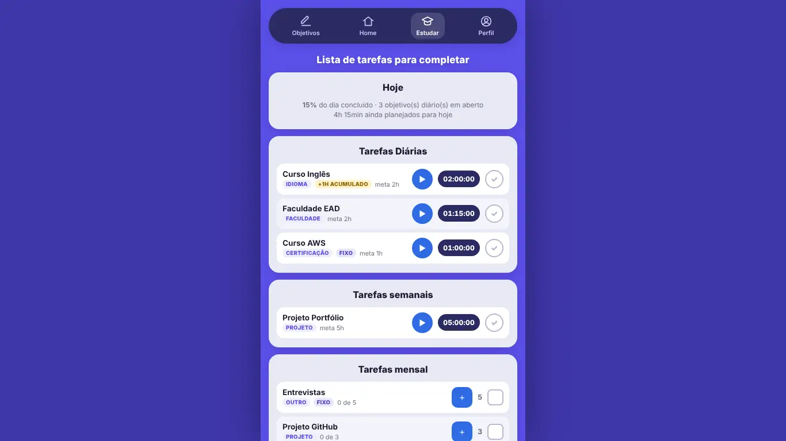

# DevLog: plataforma familiar de estudos

Aplicativo para organizar e acompanhar estudos: a pessoa cadastra objetivos diários, semanais e mensais, cronometra as sessões e ganha pontos que desbloqueiam recompensas. O projeto está em evolução e tem duas partes: um front-end que já está no ar e uma API em FastAPI feita para a versão com contas de família.



*O print mostra a tela Estudar com os dados de exemplo que o próprio app carrega pelo Perfil.*

## O que faz
- Cadastro de objetivos de estudo (com meta em horas) e de tarefas (com meta em repetições), com frequência diária, semanal ou mensal e matéria.
- Tela Estudar com a lista do dia, cronômetro por objetivo e acúmulo do tempo que sobrou de um período para o outro.
- Painel com progresso do dia, gráficos da semana e do mês e histórico mensal com tempo, tarefas e pontos.
- Pontos por estudo e por tarefa concluída.
- Relógio flutuante que pode ser arrastado, com suporte a Picture-in-Picture quando o navegador oferece.
- Backup dos dados em arquivo JSON e carga de dados de exemplo.
- Com a API ligada: contas de responsável e de dependente, e as telas Família e Prêmios, com trilhas de recompensa e níveis. Cada rota respeita o papel de quem chama.

## Como fiz
- **Front-end** em JavaScript puro com módulos ES e Vite, separado em camadas (`pages`, `services`, `stores`, `components`, `utils`). Um barramento de eventos (`core/bus.js`) evita dependência circular entre telas e regras. Os gráficos são SVG desenhado à mão, sem biblioteca. A explicação completa está em [`docs/architecture.md`](docs/architecture.md).
- **Modo local e modo com servidor.** A variável `VITE_API_URL` liga o front-end à API. Sem ela, o app guarda tudo no `localStorage`, que é como a versão publicada funciona hoje: os dados ficam só no aparelho.
- **API** em FastAPI com SQLAlchemy assíncrono, Pydantic e migrações com Alembic. O código segue camadas de rota, serviço, repositório e modelo.
- **Autenticação** com senha em Argon2, access token JWT de curta duração e refresh token opaco guardado como hash e revogável.
- **Banco de dados** modelado para PostgreSQL, com 19 tabelas descritas em [`docs/database.md`](docs/database.md). Nos testes e no desenvolvimento local a API usa SQLite.
- **Testes** da API com pytest e testes de navegador do front-end com Playwright. Os comandos estão em [`docs/rodar-local.md`](docs/rodar-local.md).
- **Publicação** do front-end no GitHub Pages por um workflow do GitHub Actions que faz o build a cada push em `frontend/`.
- O que ainda falta (como rodar a API num PostgreSQL de verdade, tempo real e deploy do backend) está listado em [`docs/o-que-falta.md`](docs/o-que-falta.md).

## Tecnologias
`JavaScript` `Vite` `HTML` `CSS` `Python` `FastAPI` `SQLAlchemy` `Alembic` `PostgreSQL` `pytest` `Playwright` `GitHub Actions`

## Como rodar
Só o front-end, em modo local:

```bash
cd frontend
npm install
npm run dev
```

Com a API (Python 3.12 ou superior, SQLite para desenvolvimento): o passo a passo completo está em [`docs/rodar-local.md`](docs/rodar-local.md).

## Acesse
https://ricardovsantos.github.io/study-eneven/

## Autor
Ricardo Vieira dos Santos · [Portfólio](https://portifolio.ricardosantosdev.tech) · [LinkedIn](https://www.linkedin.com/in/ricardo-santos-0ba84b384)
